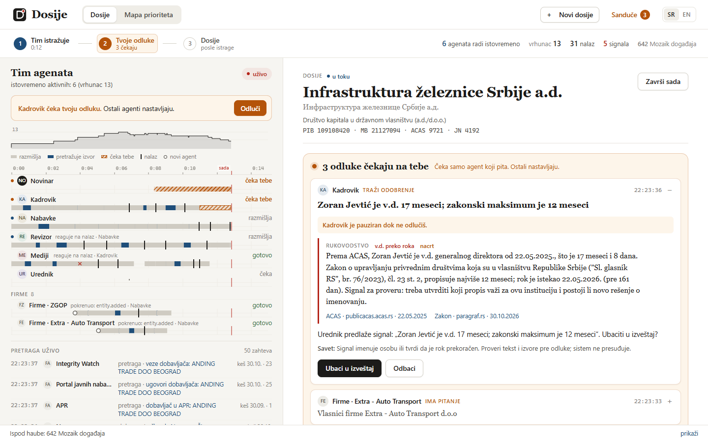
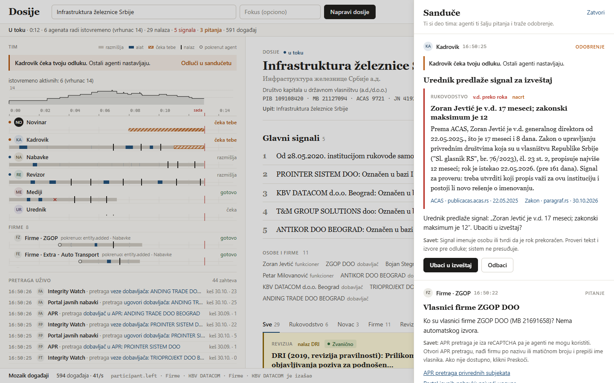
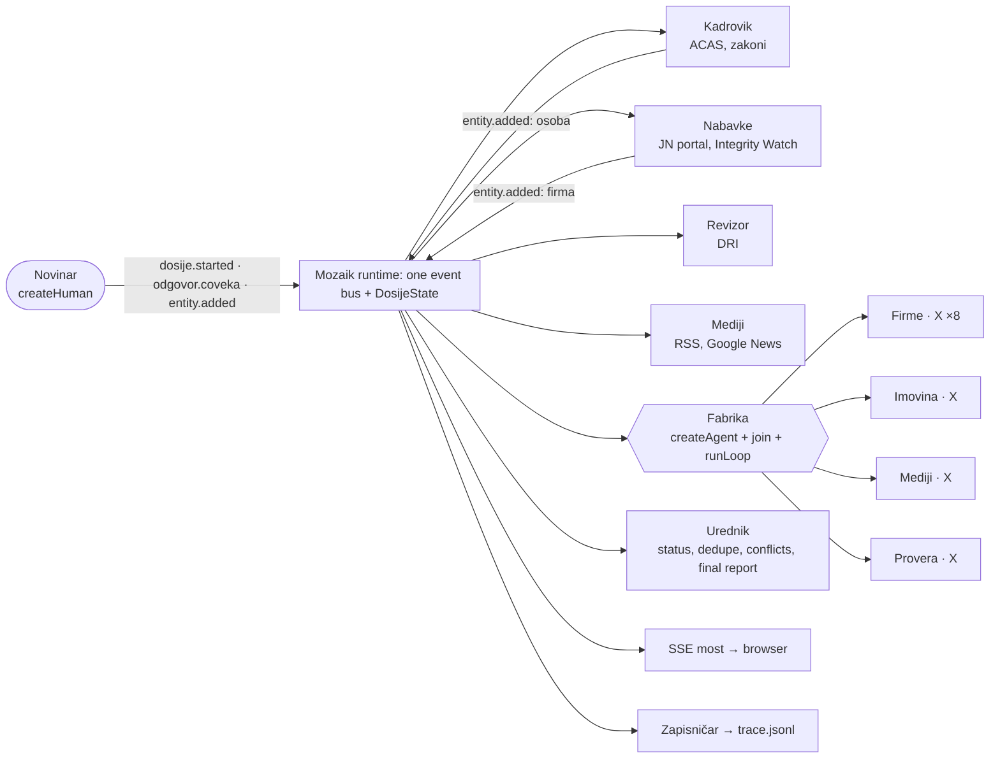

# Dosije: from breaking news to a sourced dossier in minutes

**A team of concurrent [Mozaik](https://docs.jigjoy.ai) agents investigates a Serbian public institution live on screen, and the journalist is a member of the team.**

NTP Novi Sad Hackathon 2026 · Freestyle track · built on `@mozaik-ai/core` 4.2.0



> **Ukratko (srpski).** Izađe vest „Sindikat traži ostavku rukovodstva Infrastrukture železnice". Novinarka upiše
> instituciju i za nekoliko minuta dobije dosije: ko vodi instituciju i da li je postavljen u zakonskom roku, gde idu
> pare, šta je našla revizija i šta pišu mediji. Svaka tvrdnja ima izvor, datum i status, a tu je i spisak onoga što
> mora ručno da proveri. Desetine agenata rade istovremeno nad zajedničkim dosijeom, a novinarka je član tima:
> odgovara na pitanja na koja otvoreni podaci nemaju odgovor i odobrava osetljive signale. **Sistem ne presuđuje:
> pokazuje signale za proveru, a odluka ostaje na čoveku.**

---

## The problem

When news breaks about a public institution, a journalist has to find out fast:

1. **Who runs it**, since when, appointed by whom, and whether that is within the legal limits.
2. **Where the money goes**: contracts, suppliers, procedures without a public call.
3. **What the state auditor found.**

Today that means trawling by hand through the anti-corruption agency's register (ACAS), the public procurement
portal, the company registry (APR), state audit PDFs (DRI) and old news. It takes half a day or more.

**With Dosije it takes minutes.** Every claim comes with a link, a date and a status (*zvanično* / *potvrđeno* /
*nepotvrđeno* / *demantovano*), followed by a checklist of what still needs manual verification.

**Users:**
- **Journalists and researchers** (N1, Danas, KRIK, 021, Južne vesti), the main users.
- **A transition team or a new director** taking over an institution: the dossier is literally a "popis stanja"
  (contracts in progress, audit findings, who holds which function on what basis).
- **Unions, whistleblowers and citizens** checking whether public data backs up a claim.

## What the demo finds (real data, Infrastruktura železnice Srbije)

These come from a no-key run on the committed cache of real public data (October 2026). They are **signals for
verification, not conclusions**.

| Signal | Source |
|---|---|
| **Zoran Jevtić has been acting general director (v.d.) for 17 months and 8 days**, while the maximum is 12 (Zakon o upravljanju privrednim društvima u vlasništvu RS, 76/2023, čl. 23 st. 2). The journalist approves this signal before it enters the report. | ACAS register + law text |
| **Since 28 May 2020 the company has been run only by acting directors, four in a row (77 months).** The state auditor said the same in 2020: the acting director *"više od dve godine obavljalo je funkciju vršioca dužnosti direktora Društva, što nije u skladu sa Zakonom o javnim preduzećima"*. | ACAS + DRI report 3066 |
| **1,537 contracts worth 65.36 bn RSD** (2020 to 2026). There were **10 negotiated procedures without a public call**, among them the assessment of the **Novi Sad railway station building** (29.9 M RSD, January 2025, after the canopy collapse). | Portal javnih nabavki |
| **8 suppliers flagged by Integrity Watch Srbija** as linked to officials or political parties. The open data names no person, so the system says exactly that. | Integrity Watch CSV |
| **Conflict resolved:** RTV and Tanjug called Jevtić *"novi generalni direktor"*, while ACAS lists him as *"v.d."*. The Urednik (editor agent) resolves it in favor of the official register. | ACAS vs media |
| **DRI findings** with verbatim quotes: a qualified opinion on the 2018 financial statements, and for 2022 contract award notices published up to 349 days late plus seven procurements without a documented estimated value. | 21 DRI reports |
| **Today's news:** the union "Nezavisnost" demands the management's resignation within 48 hours. | Danas, 30.10.2026 |

| | |
|---|---|
|  |  |
| **The inbox:** the Urednik proposes a sensitive signal. Only the asking agent is paused, and everyone else keeps working. The owner question exists because APR's search is behind reCAPTCHA. | **The report:** exported as Markdown or printed to PDF, with sources, statuses, conflicts and a "Šta još treba proveriti" checklist. |

## Quick start: runs without any API key

```bash
git clone <this repo> dosije && cd dosije
npm install
npm start
```

Open **http://localhost:3000** and click **"Infrastruktura železnice Srbije"**.

- **No key needed.** Without a key the app runs in **scripted mode**: the real Mozaik runtime, the real `runLoop`s,
  tools, events, shared state and interception, with a deterministic `InferenceRunner` instead of an LLM. It is
  plugged in through Mozaik's official `inferenceRunnerConfig.runner` extension point, like the
  `custom-inference-runner` example. All public data for the demo institution is committed under `data/cache/`, so
  the demo works offline and even when state websites are down.
- **Real LLM agents.** Copy `.env.example` to `.env` and set `OPENAI_API_KEY`. Workers use `gpt-5.4-mini` and the
  Urednik uses `gpt-5.4`. Anthropic and Gemini keys are auto-detected as fallbacks.
- Requires **Node.js 20 or newer**. On Windows, if PowerShell blocks `npm`, use `npm.cmd start`.

| command | what it does |
|---|---|
| `npm start` | web app on port 3000 |
| `npm run mapa` | headless Mapa prioriteta: one agent per institution, live ranking, ASCII Gantt |
| `npm run cli -- "Infrastruktura železnice Srbije"` | headless run: live log, ASCII Gantt of the agents, writes `out/dosije-*.md` |
| `npm test` | 14 tests, including a full concurrent case, the human-answer cascade, LLM mode against a fake OpenAI API and a parallel Mapa prioriteta |
| `npm run warm-cache -- "<institution>"` | fetches every public source live for another institution and caches it |

### Two-minute demo script

1. Click the demo chip. **Kadrovik, Nabavke, Revizor and Mediji start at the same moment** on one `dosije.started` event.
2. Nabavke registers suppliers. Each `entity.added` makes the **Fabrika spawn a "Firme · X" agent**, and lanes
   slide in ("← pokrenuo: entity.added · Nabavke"). Officials found by the Kadrovik spawn **Imovina** and **Mediji** agents.
3. Mediji tries to file a claim without a source. A red ✗ appears: **the Urednik's gate blocks it** (`claim.blocked`),
   and the agent retries with the article as the source.
4. The inbox shows *"Urednik predlaže signal: Zoran Jevtić je v.d. 17 meseci…"*. The **Kadrovik's lane turns amber
   ("čeka novinara ⏸") while every other lane keeps moving.** Approve it.
5. Answer an owner question (look the company up on APR and type the owner's name). The Firme agent wakes up,
   registers the person, and **Provera + Mediji agents spawn for that name**, checking the ACAS register and PEP
   lists. A human answer turns into new concurrent work.
6. Open the report and export it as `.md` or PDF.

## Mapa prioriteta: where to look first

For a **transition team or a new government**: a *list* of institutions goes through the same multi-agent system **in
parallel**, and the output is a live rank list "gde prvo gledati". It is also the strongest visual proof of
concurrency: one **"Trijaža · <institucija>"** agent per institution, all running at the same moment.


- **From the UI:** click **"Mapa prioriteta"** in the header, edit the list (one institution per line, at most 8; the
  default is the transport-sector preset in `data/static/mapa-preset.json`) and click **"Pokreni mapu"**. Rows slide into
  rank order as scores arrive; each row expands into its reasons, sources and **"Otvori dosije"** (a full case for that
  institution). A map and a case exclude each other: `POST /api/mapa` answers 409 while a case runs, and vice versa.
- **Headless:** `npm run mapa` (or `npm run mapa -- "Srbijavoz" "Koridori Srbije"`) prints the live log, the final ranking
  and the ASCII Gantt. REST: `POST /api/mapa {institutions?: string[]}`, `GET /api/mapa`.
- **No orchestrator:** the Novinar publishes `mapa.started`; the **Fabrika** reacts by resolving every institution and
  spawning one Trijaža agent each, all started in the same tick with their own `runLoop`, fresh context and UrednikGate.
  Each agent calls `trijaza_rukovodstvo` (ACAS head, v.d. check, chain), `trijaza_nabavke` (contracts, negotiated
  procedures without publication, top supplier, Integrity Watch) and `trijaza_revizija` (DRI list + opinions already
  extracted; no PDF is downloaded), then `upisi_red({summary})`. **Figures and the score are computed in code** from what
  the tools returned; the model only adds a 1-2 sentence neutral summary. Events: `mapa.started`, `mapa.red` (row upsert),
  `mapa.zavrsena` (ranking, published by the Urednik).

| signal (deterministic, `src/data/analysis/priority.ts`) | points |
|---|---|
| acting head (v.d.) past the legal limit | +40, plus min(20, months over the limit) |
| consecutive acting heads for >= 24 months (chain) | +15 |
| negotiated procedures without publication > 5% of contract value | +15 |
| ... and at least 5 such procedures | +5 |
| top supplier (without state utilities and public systems) > 40% of the value | +10 |
| suppliers flagged by Integrity Watch Srbija | +3 each, max 15 |
| DRI qualified / adverse / disclaimer opinions | +10 each, max 20 |
| at least 5 DRI reports | +5 |

Every contribution becomes a short reason with its points, so a score can always be explained. Missing data never scores:
a source that did not answer is listed as "nema podataka". DRI opinions are counted only where the PDF was already
processed, so a low DRI count means "not extracted", not "clean". **Signals for verification, not verdicts.**

**Numbers from a cached run** (`DATA_MODE=cache`, scripted, `DEMO_SPEED=1`): 6 institutions, 6 agents, **peak 6 concurrent
loops**, 24 tool calls, 30 inferences, 174 Mozaik events in **about 8 s**. The first live run that warmed the cache took 72 s.
The preset runs offline: IŽS and Srbijavoz were already cached, and the other four (Železnice Srbije, Srbija Kargo,
Putevi Srbije, Koridori Srbije) are in `data/static/institutions.json` with ACAS id, JN id, PIB and APR MB checked against
each other. A typed name that is not in that table is resolved dynamically, and the row shows what it was matched to.

| rank | institution | score | top reasons |
|---|---|---|---|
| 1 | Infrastruktura železnice Srbije | 105 | v.d. 17 mes. (rok 12), lanac v.d. 77 mes., Integrity Watch 8, DRI 1 sa rezervom |
| 2 | Putevi Srbije | 86 | v.d. 155 mes., 5 postupaka bez objave, DRI 1 sa rezervom |
| 3 | Koridori Srbije | 85 | v.d. 71 mes., najveći dobavljač 40,7%, DRI 1 sa rezervom |
| 4 | Srbija Kargo | 83 | v.d. 16 mes., lanac v.d. 109 mes., Integrity Watch 3, DRI 1 sa rezervom |
| 5 | Srbijavoz | 80 | v.d. 16 mes., lanac v.d. 52 mes., najveći dobavljač 56,8% |
| 6 | Železnice Srbije | 60 | v.d. 90 mes. |

## How the agents work together on Mozaik



Every agent's loop runs through the **UrednikGate** (`InterceptionHandler`).

### Concurrency, not a pipeline in disguise
- **There is no orchestrator.** Behavior composes by reaction:

  | event | who reacts |
  |---|---|
  | `dosije.started` | Kadrovik, Nabavke, Revizor, Mediji: four loops at once |
  | `entity.added` (firm) | Fabrika spawns a Firme agent |
  | `entity.added` (person) | Fabrika spawns Imovina and Mediji agents |
  | `finding.added` | Urednik dedupes and resolves conflicts |
  | `odgovor.coveka` | a new loop for the agent that asked |
  | `message_received.started` / `model.answer` | completion tracking |

- **Every `runLoop` is fire-and-forget**, with its own fresh `ModelContext` and its own tools and gate instance.
  Contexts are mutated in place, so sharing an agent's memory across concurrent loops would interleave them.
- **One scripted IŽS run:** peak **13 concurrent loops**, **21 agents** (16 spawned at runtime), ~105 tool calls and
  ~880 Mozaik events in about 30 s.
- **The evidence is checkable:**
  - the live Gantt and concurrency sparkline in the UI;
  - `out/trace-<case>.jsonl` (every event, written by the Zapisničar observer);
  - the CLI Gantt below;
  - `npm test`, which asserts peak concurrency ≥ 4, at least 4 runtime spawns, a blocked unsourced claim and a
    conflict won by the official source.

```
Gantt (~ inference, # tool, ! waiting for the journalist)
                        0s                                7s                               14s
Kadrovik                ~#~#~~#~#~~#####~!!!!!!!!!!!!!!!!!!!!!!~~...............................
Nabavke                 ~~##~#~#~#~####~###~#~#~###~#~##~~......................................
Revizor                 ~~#####~#~###~#~#~#~####~#~~#~~.........................................
Mediji                  ~###~~~#~##~............................................................
Urednik                 ..................................................................~~#~#~
Firme · ZGOP            .....~#~~#~#~#~....~~#~~#~..............................................
Firme · Extra - Auto Tr .......~~#####~.........................................................
Firme · ANTIKOR         .........~~###~##~~.....................................................
Firme · T&M GROUP SOLUT ...........~#~~#~##~~...................................................
Firme · KBV DATACOM     ............~#~##~##~~..................................................
Imovina · Zoran Jevtić  ...~#~##~#~~............................................................
Mediji · Zoran Jevtić   ...~~#~##~#~~...........................................................
Provera · (owner name)  .....................~~#~#~##~!!!!!!!!!!!!!!!!!!!!!!~~..................
```

### Shared state: the dossier
- `DosijeState extends RuntimeState` holds the case file: findings, entities, conflicts, human tasks, the report,
  the budget, run statistics, active loops and pending approvals.
- Every mutation goes through a domain method that publishes the matching event (`finding.added`, `entity.added`,
  `conflict.resolved`, …).
- **The Urednik** reacts to `finding.added`:
  - it computes the status from the sources: official, then two independent hosts, then one source;
  - it merges duplicates;
  - when two claims about the same subject conflict, **the official source wins** and the other becomes *demantovano*.
- **The budget lives in the shared state** and caps the fan-out: 8 firms, 6 persons, 400 tool calls, 1.5 M tokens.

### Interception: the Urednik gate
`UrednikGate implements InterceptionHandler` is attached to every loop. It intercepts **only when it acts**: a
typical run has 2 interventions, not one per call.
1. **Budget:** an agent over its tool-call limit is told to wrap up.
2. **PII scrub:** phone numbers and e-mails are removed by rewriting the call with `FunctionCallItem.rehydrate`.
3. **Source gate:** an `add_finding` without a valid http(s) source never runs. The agent receives
   `ODBIJENO: …` as the function output and must retry with a source or drop the claim.
4. **Sensitive approvals:** `VD_PREKO_ROKA` and `VLASNIK_FUNKCIONER` create a blocking task in the inbox and
   **await** the journalist's decision. Mozaik awaits `handle()` inside that one loop, so **only that agent pauses
   while all the others keep running.**

### The human is a participant, not just the user
- The journalist is a `createHuman` participant on the same bus. The REST endpoints publish events on her behalf:
  `dosije.started`, `odgovor.coveka`, `entity.added` (when she adds a lead) and `dosije.zatvori`.
- **Non-blocking questions** cover gaps that open data cannot fill. Company owners, for example, sit behind APR's
  reCAPTCHA, and CompanyWall is paid or forbids scraping.
- **Blocking approvals** cover sensitive signals that name people.

### Two inference modes, one runtime
- **LLM mode (OpenAI recommended).** `ResilientInferenceRunner` wraps Mozaik's bundled model endpoints:
  - a global semaphore (`LLM_CONCURRENCY`);
  - retries on 429, 5xx and timeouts;
  - a 90 s timeout;
  - it **never throws**. `runLoop` does not catch errors, so an exception there would be an unhandled rejection that
    kills the process.
- **Scripted mode (no key).** `ScriptedInferenceRunner` uses deterministic per-agent policies that emit the same
  tool calls an LLM would. Pacing is set with `DEMO_SPEED`. The core Mediji policy makes **one deliberate unsourced
  attempt** to demonstrate the source gate. This is documented here so nobody mistakes it for a bug.

### Mozaik features, and where to find them

| Mozaik concept | Where in Dosije |
|---|---|
| `defineRuntime<State>()`, one runtime per process | `src/mozaik/runtime.ts`, `src/mozaik/boot.ts` |
| Typed shared state (`RuntimeState`) | `src/mozaik/state.ts` (`DosijeState`), `src/mozaik/domain.ts` |
| `createAgent` (5 core + 4 dynamic kinds) | `src/mozaik/agents.ts` |
| `createHuman` (journalist, factory, 2 observers) | `src/mozaik/participants.ts` |
| Situation handlers (`SituationSpecification` + processors) | `src/mozaik/handlers.ts`, `src/mozaik/urednik.ts`, `src/mozaik/participants.ts` |
| Runtime `join` / `leave` of spawned agents | `src/mozaik/participants.ts` (Fabrika), `src/mozaik/urednik.ts` |
| `runLoop` with a fresh context, per-loop tools and an interceptor | `src/mozaik/loop.ts` |
| `InterceptionHandler` (skip, rewrite, await a human) | `src/mozaik/gate.ts` |
| Custom `SemanticEvent`s via `sendEvent` | `src/mozaik/domain.ts` (`emit`) |
| Custom `InferenceRunner` (resilient LLM, scripted) | `src/mozaik/inference/resilient.ts`, `src/mozaik/inference/scripted.ts`, `src/mozaik/inference/policies.ts` |
| Observers streaming the bus (SSE, JSONL trace) | `src/mozaik/participants.ts`, `src/mozaik/bus.ts`, `src/server.ts` |

Deeper docs:
- [`docs/ARCHITECTURE.md`](docs/ARCHITECTURE.md): the full design;
- [`docs/AGENT_BEHAVIOR.md`](docs/AGENT_BEHAVIOR.md): every agent's instructions and policy;
- [`src/shared/types.ts`](src/shared/types.ts): the wire protocol.

## Data sources: public, free, no login

| Need | Source | How | Notes |
|---|---|---|---|
| Who runs it, since when, v.d. status, appointed by | **ACAS** register of officials | JSON API behind `publicacas.acas.rs` | Cyrillic-only search (we transliterate); phone and e-mail are dropped |
| Officials' assets and incomes | ACAS asset reports | same API | summaries only, no addresses |
| Contracts, suppliers (PIB), negotiated procedures | **Portal javnih nabavki** | DevExtreme grid JSON API behind the site (unofficial) | 1,537 IŽS contracts crawled politely and cached |
| Supplier links to officials and parties | **Integrity Watch Srbija** (Transparentnost Srbija) | CSV, 2021 to 2026, 358k rows | compact index of flagged suppliers committed |
| Company age, activity, revenue, employees | **APR open data** | `openapi.apr.gov.rs`, 134,374 companies | the server sends an incomplete TLS chain; we ship the intermediate cert (`certs/`) and keep verification on |
| State audit findings | **DRI** | HTML listing + PDF text (`unpdf`) | 21 IŽS reports, verbatim excerpts |
| Appointment acts | Službeni glasnik tables of contents (paragraf.rs) | HTML | titles only |
| Legal limits for acting heads | the law texts | fixed rule table with citations | `src/data/rules/vdRules.ts`, `docs/data-sources/legal.md` |
| PEP cross-check | OpenSanctions (CC BY-NC) + KRIK profile index | bulk data | name matches are labeled "not proof of identity" |
| News | 11 outlet RSS feeds, Google News RSS, GDELT | free, no key | optional Serper.dev / Brave keys add web results |

**Gaps we do not paper over.** Company owners and directors have no legal automated source, so they become
human-in-the-loop questions. Budget payments have no open data and are left out.

Per-source notes, endpoints and caveats are in [`docs/data-sources/`](docs/data-sources/).

**Search cost, if you want more than the free feeds:**
- **Serper.dev** has 2,500 free queries (no card), then about $1 per 1k. This is the best value.
- **Brave Search API** has $5 of free credit per month, then $5 per 1k.

### Ethics
- **Signals, not accusations.** The wording is neutral, and the report opens with a disclaimer.
- **Nothing invented.** Every finding cites a fetched public source or the journalist's own input, which is labeled
  as such.
- **No personal contact data.** It is dropped in the adapters and scrubbed again by the gate.
- **Name matches are never presented as identity.**
- **The human decides** what goes into the report.

## Project layout

```
src/
  server.ts                 HTTP + SSE + REST (node:http only)
  config.ts                 modes, models, budgets
  shared/types.ts           domain + wire contracts (backend <-> UI)
  data/                     public-data layer: sources/*, analysis/*, resolver, cache, http, translit
  mozaik/                   runtime, state, agents, participants, gate, loop, urednik, tools, inference, report
public/                     UI: plain HTML/CSS/JS modules, no build step, no CDN
scripts/                    cli.ts, warm-cache.ts, probe-*.ts, mock-server.ts (UI dev)
test/                       node:test via tsx
data/cache/                 committed, PII-free cache of public data (the demo runs offline)
data/static/                APR index of 134k companies, institution aliases, curated supplier IDs
docs/                       architecture, agent behavior, per-source notes, screenshots
```

## Configuration (`.env`, all optional)

| variable | default | meaning |
|---|---|---|
| `OPENAI_API_KEY` | (none) | enables LLM mode (otherwise scripted) |
| `DOSIJE_MODEL` / `DOSIJE_EDITOR_MODEL` | `gpt-5.4-mini` / `gpt-5.4` | worker / editor models (any Mozaik bundled model) |
| `DOSIJE_REASONING` | `low` | reasoning effort for models that support it |
| `LLM_CONCURRENCY` | `8` | maximum parallel LLM calls |
| `DATA_MODE` | `auto` | `auto`: cache first, then live; `cache`: offline only; `live`: always refetch |
| `DEMO_SPEED` | `1` | scripted-mode pacing (`0.3` is fast) |
| `SERPER_API_KEY` / `BRAVE_API_KEY` | (none) | optional extra news and web search |
| `PORT` | `3000` | web server port |

## How Dosije meets the Freestyle criteria

| Criterion | Where to look |
|---|---|
| **Useful and original** (30) | A real newsroom workflow on real Serbian public data. Signals rather than verdicts. The journalist is a team member. A live demo on a story from this week. |
| **Mozaik: parallel agents, shared state** (30) | Up to 21 agents with a peak of 13 concurrent loops, spawned by reaction to events, coordinating through `DosijeState`. An interceptor pauses one agent for a human while the others keep going. Conflicts are resolved in the shared state. Mapa prioriteta runs one triage agent per institution, all at once, feeding one shared ranking. |
| **It works from the README** (25) | `npm install && npm start` with no key and no internet dependency for the demo. `npm test` is green. There is a headless CLI. |
| **README** (15) | You are reading it. |

## Limitations and next steps
- **LLM mode** is covered by a test against a fake OpenAI Responses server, including injected 429/500 errors.
  Prompts are tuned for one tool call per step, because Mozaik 4.2 executes the first function call of each response.
- **The procurement portal's API is unofficial.** DRI excerpt selection is heuristic. APR matching is by name, with
  curated PIB-to-MB pairs for the demo suppliers; the portal publishes PIB, while the registry has only MB.
- **Next:** a Mapa prioriteta over many more institutions (the portal crawl is the slow part; each institution is cached once),
  and DRI opinions extracted for every report, so the DRI signal is comparable across institutions.

## License
MIT for the code. Data belongs to its publishers under their terms: ACAS, Uprava za javne nabavke, APR (open data
license), DRI, Transparentnost Srbija / Integrity Watch, OpenSanctions (CC BY-NC 4.0), and the cited media.
