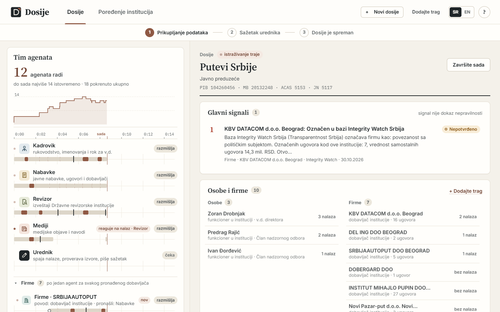
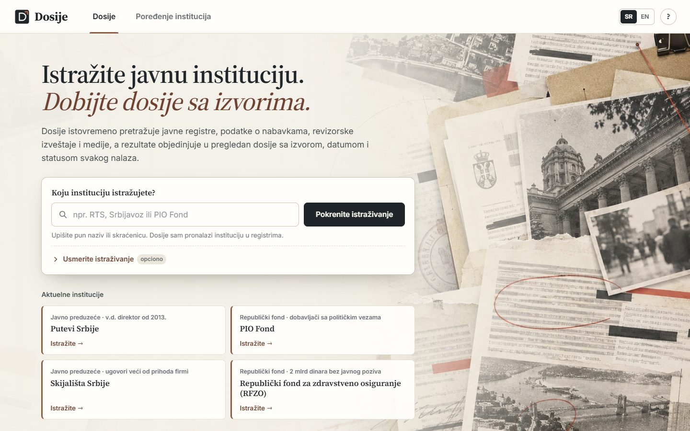
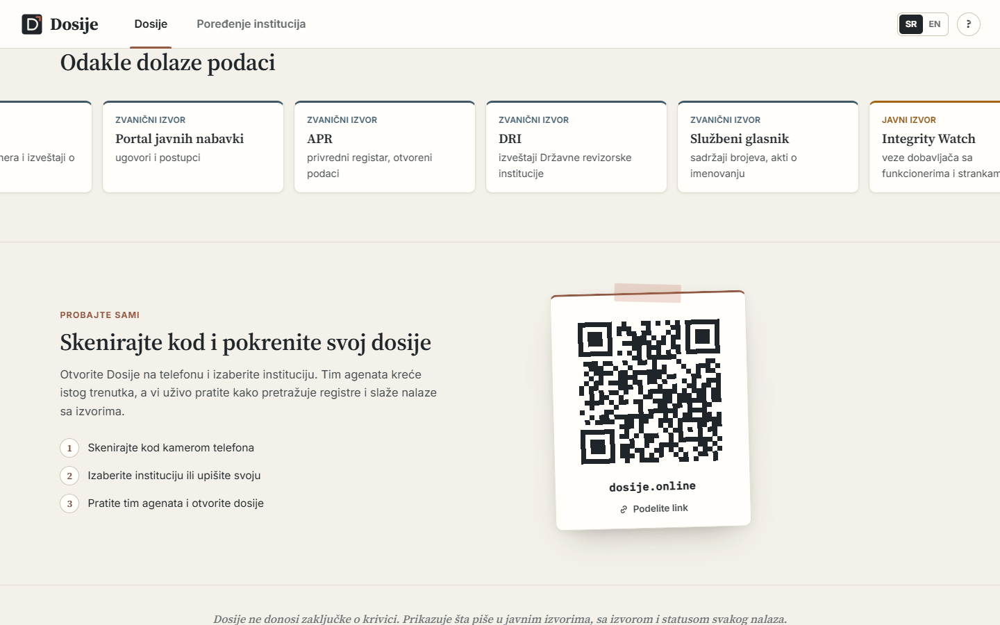
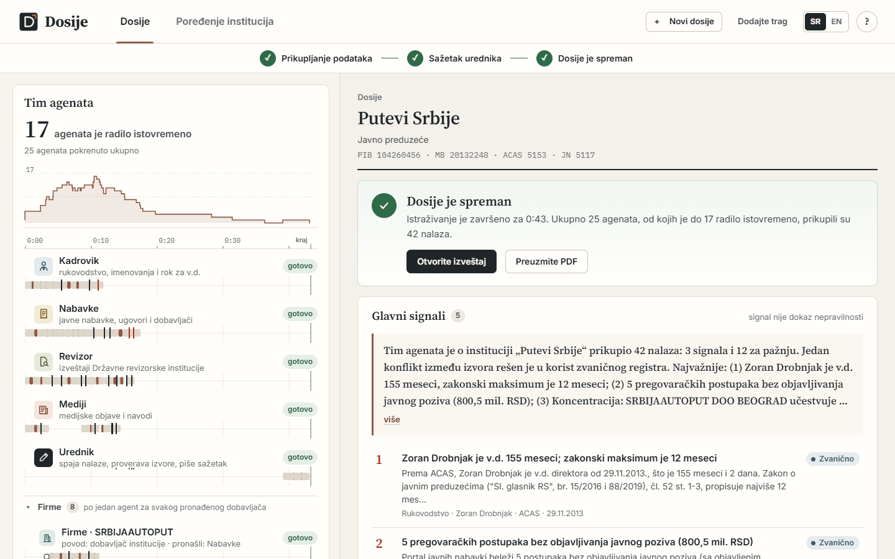
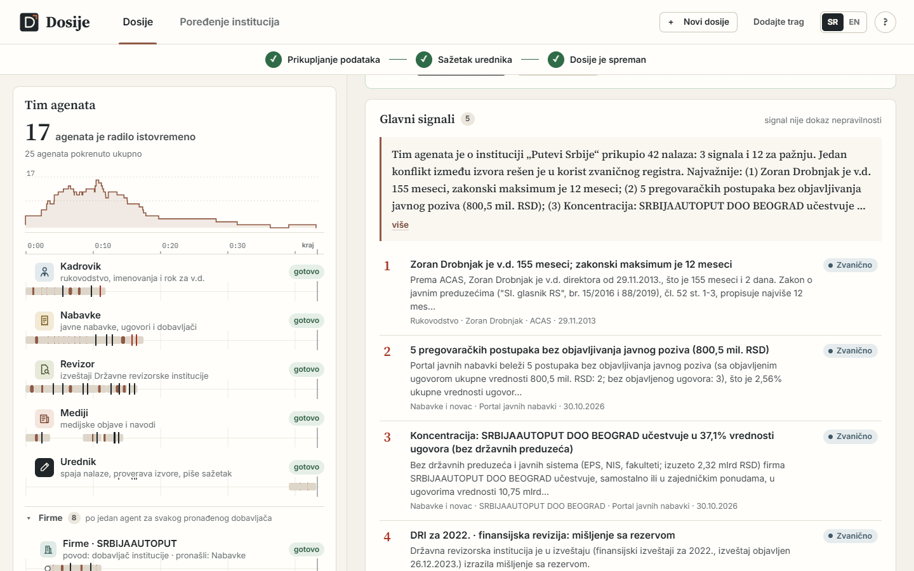
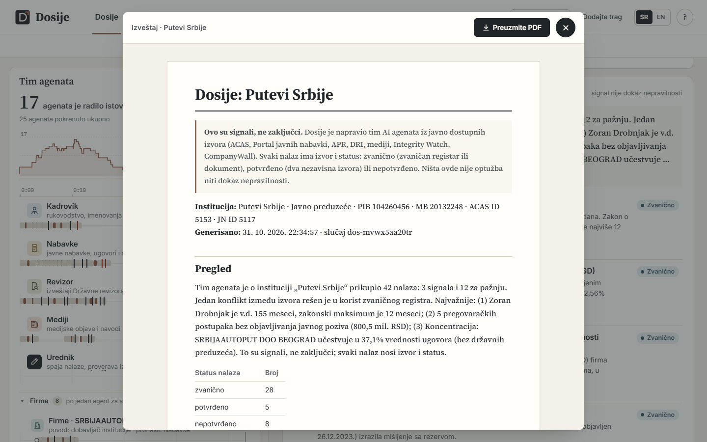
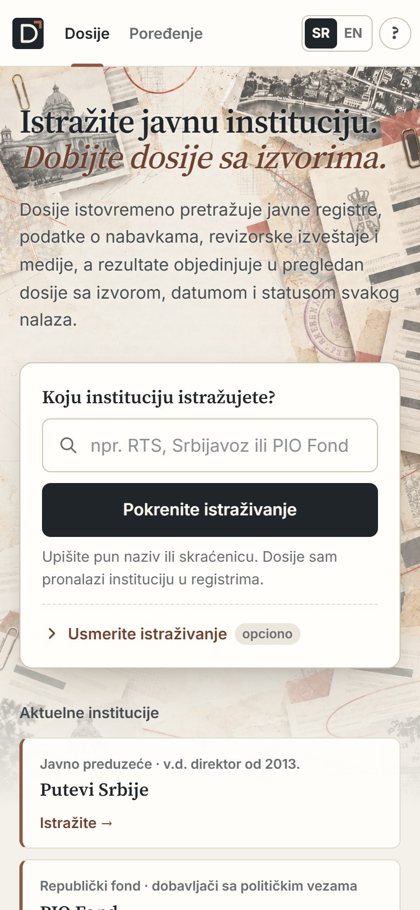
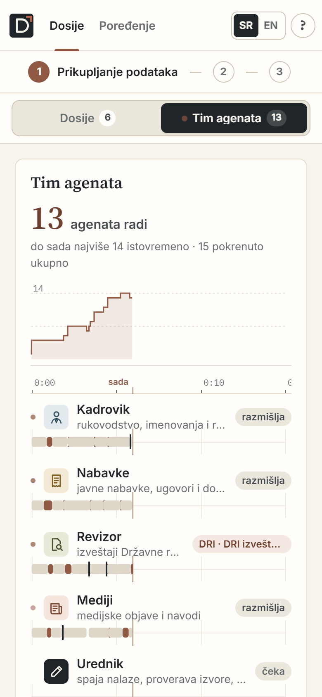
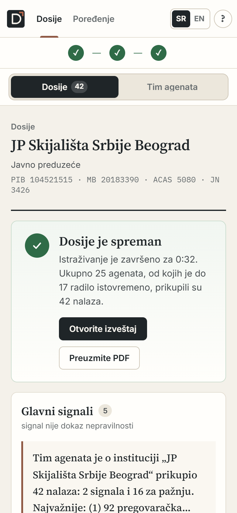

# Dosije

**From breaking news to a sourced dossier on a Serbian public institution, in about two minutes.** A team of concurrent
[Mozaik](https://docs.jigjoy.ai) agents searches public registers live and the journalist works alongside them. It shows
signals for verification, never verdicts.

**Live: [dosije.online](https://dosije.online)**. Scan the code on the start page to run it on your phone.



## Try it

Online at **[dosije.online](https://dosije.online)**, or locally in 60 seconds without an API key:

```bash
npm install
npm start          # open http://localhost:3000
```

1. On the start page, click one of the four current institutions, each chosen for a different kind of signal:
   **Putevi Srbije** (an acting director since 2013), **PIO Fond** (suppliers flagged for political ties),
   **Skijališta Srbije** (contracts larger than the suppliers' revenue) and **RFZO** (RSD 2 bn without a public call).
   Or type any institution.
2. Four agents start in the same instant. Every supplier, official and owner they find spawns another agent. The left
   column shows one timeline lane per agent and **"Pretraga uživo"**: every request to a public register, live, with
   the agent that made it.
3. The Mediji and Revizor lanes show **"reaguje na nalaz"**: agents react to each other's findings. While the team
   works you can add your own lead (**Dodajte trag**, a person or a company), and agents start on it at once.
4. The bar at the top goes **Prikupljanje podataka → Sažetak urednika → Dosije je spreman**. The editor ranks the main
   signals and writes the summary; **Otvorite izveštaj** opens the report with sources and a checklist of what still
   needs a human, and it exports to `.md` or PDF.
5. **Poređenje institucija** in the top bar compares eight institutions in parallel, one agent each, in one ranking.
   **SR | EN** switches the interface language.

On a phone the same app has one switch, **Dosije | Tim agenata**: it shows the team while the agents work and moves to
the dossier when it is ready.

**With an API key and without one:**
- With `ANTHROPIC_API_KEY` in `.env` the agents run on Claude: the workers on `claude-sonnet-5-5`, the editor
  (Urednik) on `claude-opus-5-5`. `OPENAI_API_KEY` works too (`gpt-5.4-mini` / `gpt-5.4`). This is how
  dosije.online runs.
- Without a key, a deterministic inference runner sits in Mozaik's official runner slot. Everything else is real: the
  runtime, loops, tools, events, shared state, interception, and real public data, cached in `data/cache/` (gitignored)
  after the first lookup. The screenshots here are from this mode.
- Requires Node 20 or newer. npm may print `allow-scripts` warnings; they are harmless.

|  |  |
|---|---|
| Start: type an institution or pick one of the four current ones. | "Probajte sami": scan the code and run your own dossier. |
|  |  |
| The dossier is ready: how long it took, how many agents, the report and the PDF. | The main signals, ranked by the editor; each one with its source and status. |
|  |  |
| The report: what the dossier is and is not, sources, statuses and a checklist. | Poređenje institucija: eight agents at once, one ranking and the suppliers they share. |

|  |  |  |  |
|---|---|---|---|
| Phone: the start page. | The team while it works. | The dossier, opened on its own when ready. | The same interface in English. |

## What it is

When news breaks about an institution, a journalist needs to know three things fast:
- who runs it, and whether that is within the law;
- where the money goes;
- what the state auditor found.

Today that is half a day across ACAS, the procurement portal, APR, DRI PDFs and old news. Dosije does it in minutes.
Every claim has a link, a date and a status (official, confirmed by two sources, or unconfirmed), and the dossier ends
with a checklist of what still needs a human. It is built for journalists, for transition teams taking stock of an
institution, and for citizens checking a claim.

## How the agents work together

- **There is no orchestrator; agents react to events on one Mozaik bus.** Each agent runs its own loop with its own
  context.
  - `dosije.started` starts four loops at once: **Kadrovik** (who runs it and the acting-head rules: ACAS, the law
    text), **Nabavke** (procurement portal, Integrity Watch), **Revizor** (DRI audit reports) and **Mediji** (news).
  - `entity.added` makes the Fabrika participant spawn specialists while the others keep working: **Firme** per supplier
    (APR, contracts, revenue against contract value, owners), **Imovina** and **Mediji** per official, **Provera** and
    **Mediji** per company owner (is this person an official or politically exposed: ACAS, OpenSanctions, KRIK).
  - `finding.added` from *another* agent triggers a reaction:
    - Kadrovik's "acting head past the limit" sends Mediji to check how outlets reported the appointment.
    - Nabavke's "no public call" or supplier concentration sends the Revizor after earlier DRI findings on the topic.
    - A DRI finding sends Mediji after the coverage of that audit.
  - The journalist is a participant too: a lead they add is an `entity.added` like any other and spawns agents;
    "Završite sada" closes the case for everyone.
- **Shared state.** `DosijeState` holds the dossier: the institution's identity (PIB, MB, register IDs), entities,
  findings with sources, conflicts, budget and stats. Agents build on what the others found instead of passing
  messages. The Urednik merges duplicates, assigns statuses and resolves conflicts; the official register wins.
- **Interception.** A gate on every loop checks every tool call: a closed case, the budget, personal data, and claims
  without a source, which it rejects. Blocking approval of sensitive signals and questions to the journalist are built in
  (only the asking loop waits; `DOSIJE_APPROVALS`, `DOSIJE_ASK_HUMAN`) and switched off on dosije.online, so a visitor
  gets the whole dossier without waiting.
- **Live search.** Every source request is an `izvor.upit` event, attributed to its agent.
- **A typical run with Claude** (the four current institutions on dosije.online): 27-30 loops, 11-16 of them at once
  at the peak, 125-140 model calls, about 100-110 tool calls and 1,000-1,150 Mozaik events in under two minutes. In
  scripted mode: 25 agents, up to 18 at once, in about 40 s.
  Tests assert the concurrency, spawning, blocking and conflict resolution.

The concept-by-concept map to the code is in [docs/HOW_IT_WORKS.md](docs/HOW_IT_WORKS.md).

## What it found (real data, the four current institutions)

| Signal for verification | Source |
|---|---|
| Putevi Srbije: the same acting director (v.d.) since 29 November 2013, 155 months; the legal maximum is 12. | ACAS, law text, DRI |
| RFZO: 161 negotiated procedures without a public call, RSD 2.03 bn (16.7% of the contract value). | Portal javnih nabavki |
| Skijališta Srbije: a supplier's contracts with the company (RSD 1.44 bn) exceed its own annual revenue (RSD 1.28 bn). | Portal javnih nabavki, APR |
| PIO Fond: suppliers flagged by Integrity Watch for ties to officials and parties; a supplier's owner shares a name with an official in the ACAS register (a name match, not a proven identity). | Integrity Watch, CompanyWall, ACAS, OpenSanctions |

## Commands

| command | what it does |
|---|---|
| `npm test` | the test suite: concurrency, the cascade, interception, conflicts, LLM mode against fake OpenAI and Claude APIs |
| `npm run cli -- "Srbijavoz"` | a headless dossier with an ASCII Gantt of the agents |
| `npm run mapa` | the institution comparison from the terminal |
| `npm run qa` | checks every finding's source, link and attribution |
| `npm run load -- --url <server> --users 20` | N visitors at once, each with their own cookie and dossier; checks nobody sees another's case |
| `npm run screenshots -- --url <server>` | the images in this README: a headless Chrome goes through the app (start the server with `DOSIJE_MODE=scripted`) |

## Many visitors at once (Docker)

Every visitor (a cookie) gets a session of their own: a complete engine in its own worker thread, so twenty people can
each run a dossier at the same time. The APR index is kept once for all of them. Limits shared by every session cap the
parallel LLM calls (`LLM_CONCURRENCY_TOTAL`, 20, under the API's limit of requests in flight) and the requests to each
public register (`HTTP_PER_HOST_TOTAL`). When every place is taken (`DOSIJE_MAX_SESSIONS`, 24), a new visitor sees a
page that says so and retries on its own. If an account runs out of credits, the session goes on with the scripted
policies instead of ending with an empty dossier.

```bash
docker compose up -d --build          # listens on 127.0.0.1:3100, keys from .env
sudo bash deploy/server-setup.sh      # once: the docker group, and nginx sends the bare IP to the domain
sudo bash deploy/domain-setup.sh      # dosije.online: its own nginx site, Let's Encrypt, http and www -> https
```

## Docs

- [How it works](docs/HOW_IT_WORKS.md): Mozaik concepts mapped to code, the gate, inference modes, map scoring,
  configuration and limits.
- [Architecture](docs/ARCHITECTURE.md), [agent behavior](docs/AGENT_BEHAVIOR.md), [design](docs/DESIGN.md), and the
  [data sources](docs/data-sources/): ACAS, Portal javnih nabavki, APR, DRI, Integrity Watch, Službeni glasnik,
  OpenSanctions/KRIK and news.

MIT license for the code. Data belongs to its publishers.
