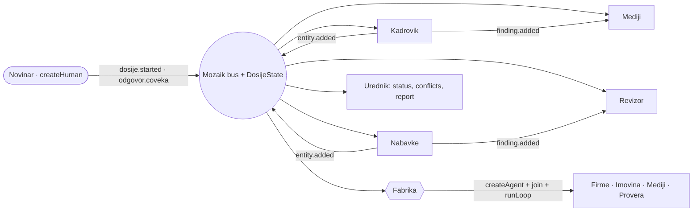

# Dosije

**From breaking news to a sourced dossier on a Serbian public institution, in minutes.** A team of concurrent
[Mozaik](https://docs.jigjoy.ai) agents searches public registers live, and the journalist is a member of the team.

NTP Novi Sad Hackathon 2026 · Freestyle track · `@mozaik-ai/core` 4.2.0


> **Ukratko.** Izađe vest o instituciji, novinarka upiše naziv i za nekoliko minuta dobije dosije:
> - ko vodi instituciju i da li je postavljen u zakonskom roku;
> - gde idu pare i šta je našla revizija;
> - šta pišu mediji.
>
> Uz svaku tvrdnju su izvor, datum i status, a na kraju spisak onoga što mora ručno da proveri. Agenti rade
> istovremeno nad zajedničkim dosijeom, a novinarka je član tima. **Sistem ne presuđuje: pokazuje signale za
> proveru.**

## Run it (no API key needed)

```bash
npm install
npm start        # open http://localhost:3000 and click "Infrastruktura železnice Srbije"
```

- **Works offline, with no key.** The demo runs on a committed cache of real public data (`data/cache/`). Without a
  key, a deterministic inference runner sits in Mozaik's official `inferenceRunnerConfig.runner` slot; the runtime,
  loops, tools, events, shared state and interception are all real.
- **Real LLM agents:** put `OPENAI_API_KEY=...` in `.env` (see `.env.example`). Workers use `gpt-5.4-mini`, the
  editor uses `gpt-5.4`.
- Requires Node 20 or newer. On Windows, use `npm.cmd` if PowerShell blocks `npm`.

| command | what it does |
|---|---|
| `npm test` | the test suite, including a full concurrent case and LLM mode against a fake OpenAI API |
| `npm run cli -- "Srbijavoz"` | headless dossier with a live log and an ASCII Gantt of the agents |
| `npm run mapa` | ranks six institutions with one agent per institution, all at once |
| `npm run qa` | checks every finding's source, link and attribution |

## What it does

When news breaks about a public institution, a journalist needs to know three things fast:
- **who runs it** and whether that is within the law;
- **where the money goes**;
- **what the state auditor found**.

Today that is half a day of manual work across the anti-corruption agency's register (ACAS), the procurement portal,
the company registry (APR), audit PDFs (DRI) and old news. Dosije does it in minutes. Every claim gets a link, a date
and a status: *zvanično*, *potvrđeno*, *nepotvrđeno*, or *odstupa od registra* when a source contradicts the
official register. The dossier ends with a checklist of what still needs a human. **It shows signals for
verification, never verdicts.**

**Users:**
- **journalists and researchers**, the main users;
- **transition teams** taking over an institution (a "popis stanja");
- **unions and citizens** checking whether public data backs a claim.

## Why it is genuinely concurrent (Mozaik)



- **There is no orchestrator.** Everything happens by reacting to events on one Mozaik bus:
  - `dosije.started`: Kadrovik, Nabavke, Revizor and Mediji start their own `runLoop` in the same tick.
  - `entity.added`: the **Fabrika** participant spawns a specialist for every supplier (Firme), official (Imovina,
    Mediji) and company owner (Provera).
  - `finding.added` **from another agent**: agents react to each other.
    - The Kadrovik's "v.d. past the legal limit" sends Mediji to look for coverage of that appointment.
    - Nabavke's "procedures without a public call" sends the Revizor to look for earlier DRI findings, and it files
      a corroborated finding.
  - `odgovor.coveka` (the journalist's answer): a new loop for the agent that asked.
- **Shared state.** `DosijeState extends RuntimeState` holds findings, entities, conflicts, tasks and the budget.
  - The **Urednik** computes statuses, merges duplicates and resolves conflicts (the official register wins).
  - The budget in the shared state caps the fan-out.
- **Interception pauses one agent, not the team.** A `UrednikGate` on every loop blocks claims without a source and
  holds sensitive signals for the journalist. Mozaik awaits `handle()` inside that one loop, so everyone else keeps
  working.
- **Live search.** Every request to a public source is an `izvor.upit` event on the bus, attributed to its agent. The
  UI shows these as "Pretraga uživo".
- **A typical cached run (IŽS, three runs, stable):**
  - peak of 13-14 concurrent loops;
  - 19 agents, 14 of them spawned at runtime;
  - 22 loops, about 100 tool calls and about 770 Mozaik events, in about 27 s.
  - Answering an owner question adds Provera and Mediji agents for that person, for 21 agents in total.
- **Proof:**
  - the live timeline in the UI;
  - `out/trace-*.jsonl`, with every event;
  - the CLI Gantt;
  - tests asserting peak concurrency, runtime spawns, a blocked unsourced claim and a conflict won by the official
    source.

| Mozaik concept | Where |
|---|---|
| `defineRuntime<State>()`, `RuntimeState` | `src/mozaik/runtime.ts`, `src/mozaik/state.ts`, `src/mozaik/domain.ts` |
| `createAgent` / `createHuman`, runtime `join` / `leave` | `src/mozaik/agents.ts`, `src/mozaik/participants.ts` |
| Situation handlers (reactions, cross-agent triggers) | `src/mozaik/handlers.ts`, `src/mozaik/urednik.ts`, `src/mozaik/participants.ts` |
| `runLoop` with a fresh context and per-loop tools | `src/mozaik/loop.ts` |
| `InterceptionHandler` (skip, rewrite, await a human) | `src/mozaik/gate.ts` |
| Custom `SemanticEvent`s (`finding.added`, `izvor.upit`, …) | `src/mozaik/domain.ts`, `src/mozaik/activity.ts` |
| Custom `InferenceRunner` (resilient LLM, scripted) | `src/mozaik/inference/` |

## What the demo finds (real data, October 2026)

| Signal for verification | Source |
|---|---|
| Zoran Jevtić has been acting director (v.d.) for 17 months; the legal maximum is 12 (Law 76/2023, art. 23). The journalist approves the signal first. | ACAS register, law text |
| Only acting directors since May 2020, four in a row. DRI flagged the same in 2020: v.d. *"više od dve godine … nije u skladu sa Zakonom"*. | ACAS, DRI report 3066 |
| 1,537 contracts worth 65.36 bn RSD. Ten negotiated procedures without a public call, including the structural assessment of the Novi Sad railway station building. | Portal javnih nabavki |
| Eight suppliers flagged by Integrity Watch Srbija. The open data names no person, and the dossier says so. | Integrity Watch |
| Media called Jevtić *"generalni direktor"*; ACAS lists *"v.d."*. The editor marks the media claim as differing from the register. | ACAS vs RTV |
| A press review with about 20 linked articles, each naming the institution. | Google News, outlet RSS |

| | |
|---|---|
|  |  |
| The **inbox**: only the asking agent pauses. The owner question exists because APR's search is behind reCAPTCHA. | The **report**: `.md` or PDF, with sources, statuses and the "Šta još treba proveriti" checklist. |


## Data

There are nine public sources, mostly through the JSON APIs behind state websites:
- ACAS officials and asset reports;
- Portal javnih nabavki;
- APR open data (134k companies);
- DRI reports, with PDF text extracted;
- Integrity Watch Srbija;
- Službeni glasnik contents;
- OpenSanctions and KRIK;
- news from RSS feeds, Google News and GDELT.

Everything is cached without personal contact data. Company owners have no legal automated source, so they become a
question to the journalist. Per-source notes are in [`docs/data-sources/`](docs/data-sources/).

## Freestyle criteria: where to look

| Criterion | Evidence |
|---|---|
| Useful and original | A real newsroom workflow on real Serbian data. Signals, not verdicts. The human is in the team. |
| Mozaik: parallel agents, shared state | Fan-out by events, agents reacting to each other's findings, `DosijeState`, and interception that pauses one loop. |
| Runs from the README | `npm install && npm start`, with no key and no network needed for the demo; `npm test` is green. |
| README | This page. Details are in [`docs/HOW_IT_WORKS.md`](docs/HOW_IT_WORKS.md). |

## More
- [`docs/HOW_IT_WORKS.md`](docs/HOW_IT_WORKS.md): Mapa prioriteta scoring, the gate's policies, inference modes,
  configuration, data sources, limitations.
- [`docs/ARCHITECTURE.md`](docs/ARCHITECTURE.md), [`docs/AGENT_BEHAVIOR.md`](docs/AGENT_BEHAVIOR.md),
  [`docs/DESIGN.md`](docs/DESIGN.md), [`src/shared/types.ts`](src/shared/types.ts) (the wire protocol).

License: MIT for the code. Data belongs to its publishers (ACAS, UJN, APR, DRI, Transparentnost Srbija,
OpenSanctions CC BY-NC, cited media).
