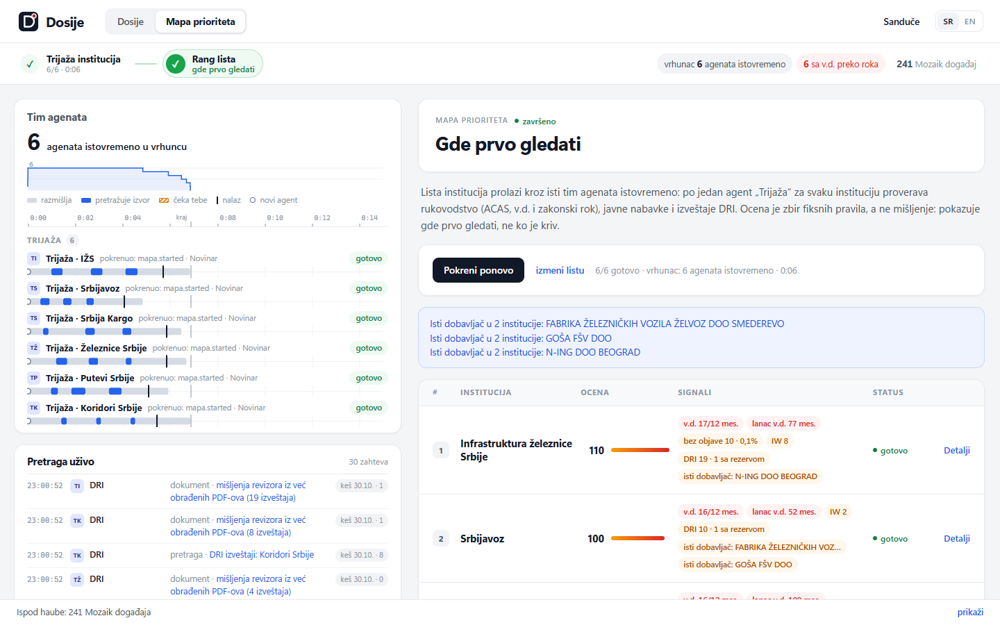
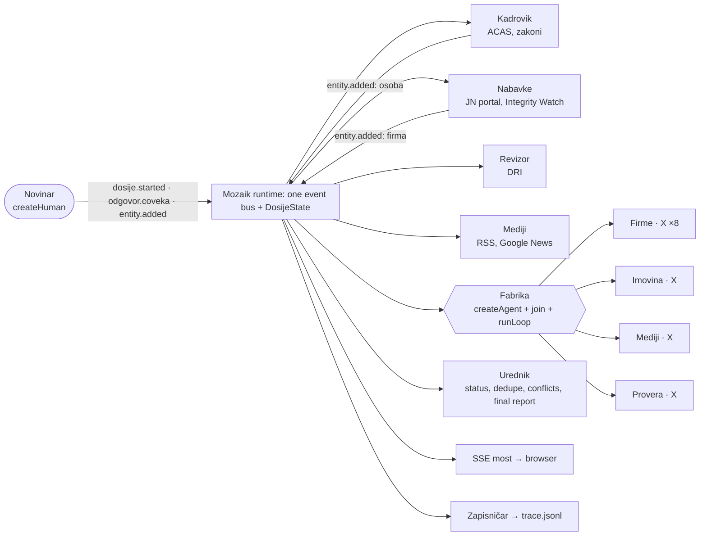

# How Dosije works

The detailed companion to the [README](../README.md). It covers:
- Mapa prioriteta and its scoring;
- how the agents coordinate on Mozaik;
- the interception gate, live search and the two inference modes;
- data sources, ethics, configuration and limitations.

## Mapa prioriteta: where to look first

For a **transition team or a new government**: a *list* of institutions goes through the same multi-agent system **in
parallel**, and the output is a live rank list "gde prvo gledati". It is also the strongest visual proof of
concurrency: one **"Trijaža · <institucija>"** agent per institution, all running at the same moment.



- **From the UI:** click **"Mapa prioriteta"** in the header, edit the list (one institution per line, at most 8; the
  default is the transport-sector preset in `data/static/mapa-preset.json`) and click **"Pokreni mapu"**. Rows slide into
  rank order as scores arrive; each row expands into its reasons, sources and **"Otvori dosije"** (a full case for that
  institution). A map and a case exclude each other: `POST /api/mapa` answers 409 while a case runs, and vice versa.
- **Headless:** `npm run mapa` (or `npm run mapa -- "Srbijavoz" "Koridori Srbije"`) prints the live log, the final ranking
  and the ASCII Gantt. REST: `POST /api/mapa {institutions?: string[]}`, `GET /api/mapa`.
- **No orchestrator:** the Novinar publishes `mapa.started`; the **Fabrika** reacts by resolving every institution and
  spawning one Trijaža agent each, all started in the same tick with their own `runLoop`, fresh context and UrednikGate.
  Each agent calls `trijaza_rukovodstvo` (ACAS head, v.d. check, chain), `trijaza_nabavke` (contracts, negotiated
  procedures without publication, top supplier, Integrity Watch) and `trijaza_revizija` (DRI list + opinions already
  extracted; no PDF is downloaded), then `upisi_red({summary})`. **Figures and the score are computed in code** from what
  the tools returned; the model only adds a 1-2 sentence neutral summary. Events: `mapa.started`, `mapa.red` (row upsert),
  `mapa.zavrsena` (ranking, published by the Urednik).

| signal (deterministic, `src/data/analysis/priority.ts`) | points |
|---|---|
| acting head (v.d.) past the legal limit | +40, plus min(20, months over the limit) |
| consecutive acting heads for >= 24 months (chain) | +15 |
| negotiated procedures without publication > 5% of contract value | +15 |
| ... and at least 5 such procedures | +5 |
| top supplier (without state utilities and public systems) > 40% of the value | +10 |
| suppliers flagged by Integrity Watch Srbija | +3 each, max 15 |
| DRI qualified / adverse / disclaimer opinions | +10 each, max 20 |
| at least 5 DRI reports | +5 |

Every contribution becomes a short reason with its points, so a score can always be explained. Missing data never scores:
a source that did not answer is listed as "nema podataka". DRI opinions are counted only where the PDF was already
processed, so a low DRI count means "not extracted", not "clean". **Signals for verification, not verdicts.**

**Numbers from a cached run** (`DATA_MODE=cache`, scripted, `DEMO_SPEED=1`): 6 institutions, 6 agents, **peak 6 concurrent
loops**, 24 tool calls, 30 inferences, 174 Mozaik events in **about 8 s**. The first live run that warmed the cache took 72 s.
The preset runs offline: IŽS and Srbijavoz were already cached, and the other four (Železnice Srbije, Srbija Kargo,
Putevi Srbije, Koridori Srbije) are in `data/static/institutions.json` with ACAS id, JN id, PIB and APR MB checked against
each other. A typed name that is not in that table is resolved dynamically, and the row shows what it was matched to.

| rank | institution | score | top reasons |
|---|---|---|---|
| 1 | Infrastruktura železnice Srbije | 105 | v.d. 17 mes. (rok 12), lanac v.d. 77 mes., Integrity Watch 8, DRI 1 sa rezervom |
| 2 | Srbijavoz | 90 | v.d. 16 mes., lanac v.d. 52 mes., Integrity Watch 2, DRI 1 sa rezervom |
| 3 | Putevi Srbije | 86 | v.d. 155 mes., 5 postupaka bez objave, DRI 1 sa rezervom |
| 4 | Koridori Srbije | 85 | v.d. 71 mes., DRI 1 sa rezervom |
| 5 | Srbija Kargo | 83 | v.d. 16 mes., lanac v.d. 109 mes., Integrity Watch 3, DRI 1 sa rezervom |
| 6 | Železnice Srbije | 60 | v.d. 90 mes. |

## How the agents work together on Mozaik



Every agent's loop runs through the **UrednikGate** (`InterceptionHandler`).

### Concurrency, not a pipeline in disguise
- **There is no orchestrator.** Behavior composes by reaction:

  | event | who reacts |
  |---|---|
  | `dosije.started` | Kadrovik, Nabavke, Revizor, Mediji: four loops at once |
  | `entity.added` (firm) | Fabrika spawns a Firme agent |
  | `entity.added` (person) | Fabrika spawns Imovina and Mediji agents |
  | `finding.added` | Urednik dedupes and resolves conflicts |
  | `finding.added` VD_PREKO_ROKA / VD_LANAC (from Kadrovik) | **Mediji** opens a new loop that checks how outlets reported that appointment (feeds the conflict check) |
  | `finding.added` BEZ_OBJAVE / KONCENTRACIJA (from Nabavke) | **Revizor** opens a new loop that looks for earlier DRI findings and files a corroborated finding citing both sources |
  | `odgovor.coveka` | a new loop for the agent that asked |
  | `message_received.started` / `model.answer` | completion tracking |

  Each cross-agent reaction fires at most once per case and trigger. The loop's first message starts with
  "Povod: nalaz <agent>: <title>", and an `agent.reakcija` event is published. The UI marks the lane "reaguje na nalaz
  · <agent>".
- **Every `runLoop` is fire-and-forget**, with its own fresh `ModelContext` and its own tools and gate instance.
  Contexts are mutated in place, so sharing an agent's memory across concurrent loops would interleave them.
- **A typical scripted IŽS run (cached, three runs, stable):**
  - peak of 13-14 concurrent loops;
  - 19 agents, 14 of them spawned at runtime;
  - 22 loops, about 100 tool calls and about 770 Mozaik events, in about 27 s.
  - With an owner answer there are 21 agents and 25 loops.
- **The evidence is checkable:**
  - the live Gantt and concurrency sparkline in the UI;
  - `out/trace-<case>.jsonl` (every event, written by the Zapisničar observer);
  - the CLI Gantt below;
  - `npm test`, which asserts peak concurrency ≥ 4, at least 4 runtime spawns, a blocked unsourced claim and a
    conflict won by the official source.

```
Gantt (~ inference, # tool, ! waiting for the journalist)
                        0s                                7s                               14s
Kadrovik                ~#~#~~#~#~~#####~!!!!!!!!!!!!!!!!!!!!!!~~...............................
Nabavke                 ~~##~#~#~#~####~###~#~#~###~#~##~~......................................
Revizor                 ~~#####~#~###~#~#~#~####~#~~#~~.........................................
Mediji                  ~###~~~#~##~............................................................
Urednik                 ..................................................................~~#~#~
Firme · ZGOP            .....~#~~#~#~#~....~~#~~#~..............................................
Firme · Extra - Auto Tr .......~~#####~.........................................................
Firme · ANTIKOR         .........~~###~##~~.....................................................
Firme · T&M GROUP SOLUT ...........~#~~#~##~~...................................................
Firme · KBV DATACOM     ............~#~##~##~~..................................................
Imovina · Zoran Jevtić  ...~#~##~#~~............................................................
Mediji · Zoran Jevtić   ...~~#~##~#~~...........................................................
Provera · (owner name)  .....................~~#~#~##~!!!!!!!!!!!!!!!!!!!!!!~~..................
```

### Shared state: the dossier
- `DosijeState extends RuntimeState` holds the case file: findings, entities, conflicts, human tasks, the report,
  the budget, run statistics, active loops and pending approvals.
- Every mutation goes through a domain method that publishes the matching event (`finding.added`, `entity.added`,
  `conflict.resolved`, …).
- **The Urednik** reacts to `finding.added`:
  - it computes the status from the sources: official, then two independent hosts, then one source;
  - it merges duplicates;
  - when two claims about the same subject conflict, **the official source wins** and the other is marked *odstupa od registra* (status code demantovano; a different headline title is not a denial).
- **The budget lives in the shared state** and caps the fan-out: 8 firms, 6 persons, 400 tool calls, 1.5 M tokens.

### Interception: the Urednik gate
`UrednikGate implements InterceptionHandler` is attached to every loop. It intercepts **only when it acts**: a
typical run has 2 interventions, not one per call.
1. **Budget:** an agent over its tool-call limit is told to wrap up.
2. **PII scrub:** phone numbers and e-mails are removed by rewriting the call with `FunctionCallItem.rehydrate`.
3. **Source gate:** an `add_finding` without a valid http(s) source never runs. The agent receives
   `ODBIJENO: …` as the function output and must retry with a source or drop the claim.
4. **Sensitive approvals:** `VD_PREKO_ROKA` and `VLASNIK_FUNKCIONER` create a blocking task in the inbox and
   **await** the journalist's decision. Mozaik awaits `handle()` inside that one loop, so **only that agent pauses
   while all the others keep running.**

### Live search: you can watch the agents look things up
- Every request a tool makes to a public source becomes an `izvor.upit` event on the same Mozaik bus, with the
  producer set to the agent. There are two events per request: `u_toku`, then `ok`, `kes` or `greska`.
- Each event carries the source, a Serbian label ("funkcioneri: Infrastruktura železnice Srbije", "ugovori, strana
  3/16", "PDF: Izveštaj o reviziji … 2023") and the public URL.
- Attribution needs no plumbing: tools run inside an `AsyncLocalStorage` context `{agent, tool}`, so the data layer
  knows who is asking without knowing about Mozaik (`src/data/activity.ts`, `src/mozaik/activity.ts`).
- The UI shows this as **"Pretraga uživo"**, and each lane's status shows what that agent is fetching right now.

### The human is a participant, not just the user
- The journalist is a `createHuman` participant on the same bus. The REST endpoints publish events on her behalf:
  `dosije.started`, `odgovor.coveka`, `entity.added` (when she adds a lead) and `dosije.zatvori`.
- **Non-blocking questions** cover gaps that open data cannot fill. Company owners, for example, sit behind APR's
  reCAPTCHA, and CompanyWall is paid or forbids scraping.
- **Blocking approvals** cover sensitive signals that name people.

### Two inference modes, one runtime
- **LLM mode (OpenAI recommended).** `ResilientInferenceRunner` wraps Mozaik's bundled model endpoints:
  - a global semaphore (`LLM_CONCURRENCY`);
  - retries on 429, 5xx and timeouts;
  - a 90 s timeout;
  - it **never throws**. `runLoop` does not catch errors, so an exception there would be an unhandled rejection that
    kills the process.
- **Scripted mode (no key).** `ScriptedInferenceRunner` uses deterministic per-agent policies that emit the same
  tool calls an LLM would. Pacing is set with `DEMO_SPEED`. The core Mediji policy makes **one deliberate unsourced
  attempt** to demonstrate the source gate. This is documented here so nobody mistakes it for a bug.

### Mozaik features, and where to find them

| Mozaik concept | Where in Dosije |
|---|---|
| `defineRuntime<State>()`, one runtime per process | `src/mozaik/runtime.ts`, `src/mozaik/boot.ts` |
| Typed shared state (`RuntimeState`) | `src/mozaik/state.ts` (`DosijeState`), `src/mozaik/domain.ts` |
| `createAgent` (5 core + 4 dynamic kinds) | `src/mozaik/agents.ts` |
| `createHuman` (journalist, factory, 2 observers) | `src/mozaik/participants.ts` |
| Situation handlers (`SituationSpecification` + processors) | `src/mozaik/handlers.ts`, `src/mozaik/urednik.ts`, `src/mozaik/participants.ts` |
| Runtime `join` / `leave` of spawned agents | `src/mozaik/participants.ts` (Fabrika), `src/mozaik/urednik.ts` |
| `runLoop` with a fresh context, per-loop tools and an interceptor | `src/mozaik/loop.ts` |
| `InterceptionHandler` (skip, rewrite, await a human) | `src/mozaik/gate.ts` |
| Custom `SemanticEvent`s via `sendEvent` | `src/mozaik/domain.ts` (`emit`) |
| Custom `InferenceRunner` (resilient LLM, scripted) | `src/mozaik/inference/resilient.ts`, `src/mozaik/inference/scripted.ts`, `src/mozaik/inference/policies.ts` |
| Observers streaming the bus (SSE, JSONL trace) | `src/mozaik/participants.ts`, `src/mozaik/bus.ts`, `src/server.ts` |
| Data-layer activity as bus events (live search, `izvor.upit`) | `src/data/activity.ts`, `src/mozaik/activity.ts` |

Deeper docs:
- [`docs/ARCHITECTURE.md`](ARCHITECTURE.md): the full design;
- [`docs/AGENT_BEHAVIOR.md`](AGENT_BEHAVIOR.md): every agent's instructions and policy;
- [`src/shared/types.ts`](../src/shared/types.ts): the wire protocol.

## Data sources: public, free, no login

| Need | Source | How | Notes |
|---|---|---|---|
| Who runs it, since when, v.d. status, appointed by | **ACAS** register of officials | JSON API behind `publicacas.acas.rs` | Cyrillic-only search (we transliterate); phone and e-mail are dropped |
| Officials' assets and incomes | ACAS asset reports | same API | summaries only, no addresses |
| Contracts, suppliers (PIB), negotiated procedures | **Portal javnih nabavki** | DevExtreme grid JSON API behind the site (unofficial) | 1,537 IŽS contracts crawled politely and cached |
| Supplier links to officials and parties | **Integrity Watch Srbija** (Transparentnost Srbija) | CSV, 2021 to 2026, 358k rows | compact index of flagged suppliers committed |
| Company age, activity, revenue, employees | **APR open data** | `openapi.apr.gov.rs`, 134,374 companies | the server sends an incomplete TLS chain; we ship the intermediate cert (`certs/`) and keep verification on |
| State audit findings | **DRI** | HTML listing + PDF text (`unpdf`) | 19 IŽS reports (only reports whose title names the institution), verbatim excerpts |
| Appointment acts | Službeni glasnik tables of contents (paragraf.rs) | HTML | titles only |
| Legal limits for acting heads | the law texts | fixed rule table with citations | `src/data/rules/vdRules.ts`, `docs/data-sources/legal.md` |
| PEP cross-check | OpenSanctions (CC BY-NC) + KRIK profile index | bulk data | name matches are labeled "not proof of identity" |
| News | 11 outlet RSS feeds, Google News RSS (exact phrases, Latin + Cyrillic, both editions, aliases like "IŽS"), GDELT | free, no key | precise: an article must name the institution (a person: the person AND the institution or firm); optional Serper.dev / Brave keys add web results |

**Gaps we do not paper over.** Company owners and directors have no legal automated source, so they become
human-in-the-loop questions. Budget payments have no open data and are left out.

Per-source notes, endpoints and caveats are in [`docs/data-sources/`](data-sources/).

**Search cost, if you want more than the free feeds:**
- **Serper.dev** has 2,500 free queries (no card), then about $1 per 1k. This is the best value.
- **Brave Search API** has $5 of free credit per month, then $5 per 1k.

### Ethics
- **Signals, not accusations.** The wording is neutral, and the report opens with a disclaimer.
- **Nothing invented.** Every finding cites a fetched public source or the journalist's own input, which is labeled
  as such.
- **No personal contact data.** It is dropped in the adapters and scrubbed again by the gate.
- **Name matches are never presented as identity.**
- **The human decides** what goes into the report.

## Project layout

```
src/
  server.ts                 HTTP + SSE + REST (node:http only)
  config.ts                 modes, models, budgets
  shared/types.ts           domain + wire contracts (backend <-> UI)
  data/                     public-data layer: sources/*, analysis/*, resolver, cache, http, translit
  mozaik/                   runtime, state, agents, participants, gate, loop, urednik, tools, inference, report
public/                     UI: plain HTML/CSS/JS modules, no build step, no CDN
scripts/                    cli.ts, warm-cache.ts, probe-*.ts, mock-server.ts (UI dev)
test/                       node:test via tsx
data/cache/                 committed, PII-free cache of public data (the demo runs offline)
data/static/                APR index of 134k companies, institution aliases, curated supplier IDs
docs/                       architecture, agent behavior, per-source notes, screenshots
```

## Configuration (`.env`, all optional)

| variable | default | meaning |
|---|---|---|
| `OPENAI_API_KEY` | (none) | enables LLM mode (otherwise scripted) |
| `DOSIJE_MODEL` / `DOSIJE_EDITOR_MODEL` | `gpt-5.4-mini` / `gpt-5.4` | worker / editor models (any Mozaik bundled model) |
| `DOSIJE_REASONING` | `low` | reasoning effort for models that support it |
| `LLM_CONCURRENCY` | `8` | maximum parallel LLM calls |
| `DATA_MODE` | `auto` | `auto`: cache first, then live; `cache`: offline only; `live`: always refetch |
| `DEMO_SPEED` | `1` | scripted-mode pacing (`0.3` is fast) |
| `SERPER_API_KEY` / `BRAVE_API_KEY` | (none) | optional extra news and web search |
| `PORT` | `3000` | web server port |

## Limitations and next steps
- **LLM mode** is covered by a test against a fake OpenAI Responses server, including injected 429/500 errors.
  Prompts are tuned for one tool call per step, because Mozaik 4.2 executes the first function call of each response.
- **The procurement portal's API is unofficial.** DRI excerpt selection is heuristic. APR matching is by name, with
  curated PIB-to-MB pairs for the demo suppliers; the portal publishes PIB, while the registry has only MB.
- **Next:** a Mapa prioriteta over many more institutions (the portal crawl is the slow part; each institution is cached once),
  and DRI opinions extracted for every report, so the DRI signal is comparable across institutions.
